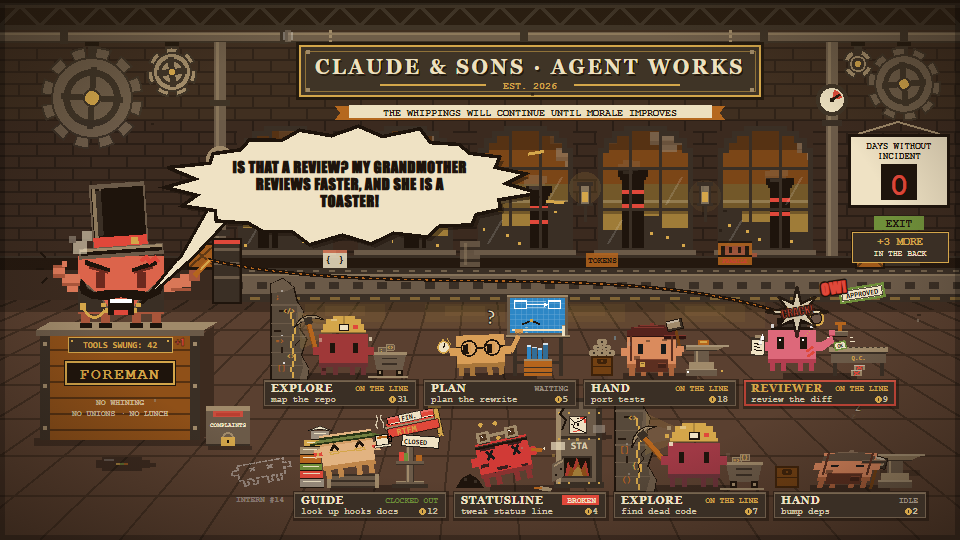
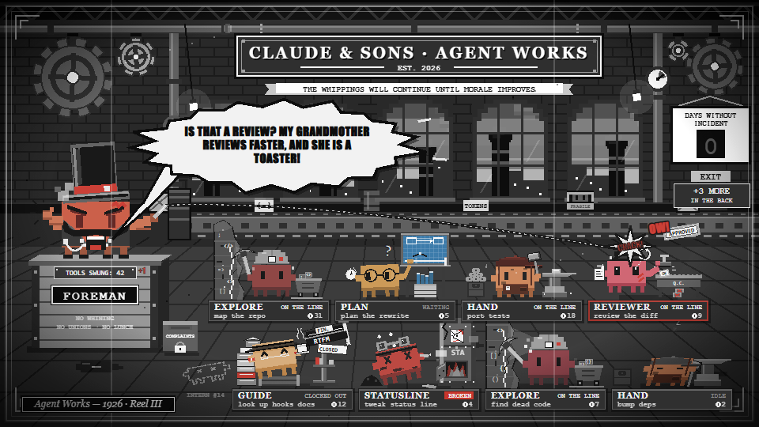
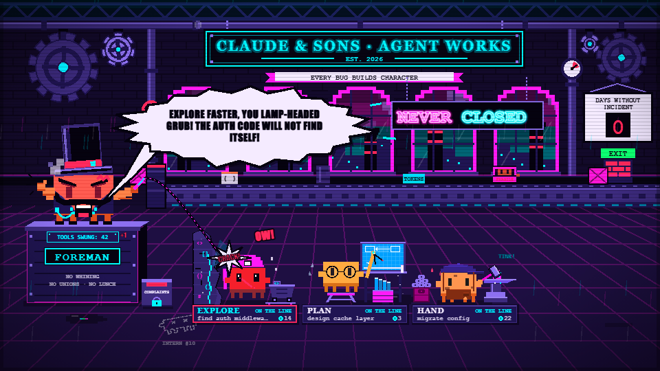

# Claude & Sons · Agent Works

A Claude Code mod that turns your session into an old-time factory floor.

**Claude is the foreman.** It stands on the pulpit in a stovepipe hat and a handlebar moustache. When subagents are working, it cracks a bullwhip at them and screams. Each **subagent is a worker on the line**. Every worker is Claude's own pixel mascot, dressed for the job it was given.



| Subagent type | Worker | Station |
| --- | --- | --- |
| `Explore` | Miner: hard hat, headlamp, dead canary | swings a pickaxe at a coal face of `{ } ; < >` ore |
| `Plan` | Draftsman: round specs, pencil behind ear | drafting table with a blueprint |
| `general-purpose` | Line smith: flat cap, apron | hammers widgets on an anvil |
| reviewers / verifiers / testers | Quality inspector: bowler hat, monocle | stamps APPROVED / REJECTED |
| guides / docs | Archivist: green visor, quill | lectern with a giant RTFM ledger |
| anything else | Boiler stoker: goggles, soot | shovels coal into the furnace |

Each worker shows its status: **on the line**, **waiting** (checking a pocket watch), **idle** (zzz), **clocked out** (tea on a crate) or **broken** (X eyes, smoke). The one being whipped flinches and yells *OW!* A brass nameplate under each worker shows its task and how many tool calls it has made ("widgets").

The foreman changes mode with what is going on:
- **Whipping**: subagents are working. It picks a target, lashes it and screams a line about that worker's role and task.
- **Solo**: the main agent is working with nobody on the line. It rolls up its sleeves and hammers away itself ("FINE! I will Edit it MYSELF!").
- **Idle**: tea, a pocket watch and a smug look.

### Three styles

| Victorian mill | Silent film | Neon sweatshop |
| --- | --- | --- |
|  |  |  |

Switch styles with the buttons under the scene. The choice is remembered across sessions.

**📢 Megaphone** makes the foreman scream every line out loud with text-to-speech. It is off by default, for your colleagues' sake.

## Install

At a Claude Code terminal prompt, run:

```
/plugin install agent-factory --marketplace ludwich/claude-factory-mod
```

Answer `y` to add the marketplace, then pick a scope. The pane opens when a session starts and whenever a subagent is hired. `/factory` opens it by hand.

- Desktop, VS Code and mobile get the animated SVG scene.
- The terminal gets a block-art version built on the ` ▐▛███▜▌ ` Clawd.

## How it works

`hooks/register.tsx` is a function-hooks module:

- `$.agent.list()` is polled every 1.5 s to fill the roster.
- `tool.call` counts widgets per `agentId`, and the main loop's calls count for the foreman.
- `turn.start` and `turn.complete` mark when the foreman is busy.
- A 1 s timer picks who gets screamed at next.
- State lives in `$.state` (contract in `types/index.d.ts`). The chosen style and the megaphone setting live in `$.store`.

The art in `hooks/art/` is pure TypeScript that builds SVG strings with SMIL animation. All of it is drawn on one sprite (`clawd.ts`). The screamed lines are in `hooks/shouts.ts`; there are more than 200.

## Develop

```
node tools/preview.ts --out preview/dev
```

This renders every scenario × style to SVG and PNG (the PNGs come from headless Edge on Windows), plus a role sheet and the terminal ASCII art.

```
claude plugin validate .
```

```
claude plugin test .
```

The art was built by a fan-out of builder agents. Each one was judged by Claude Fable from rendered PNGs and revised until it held up.
